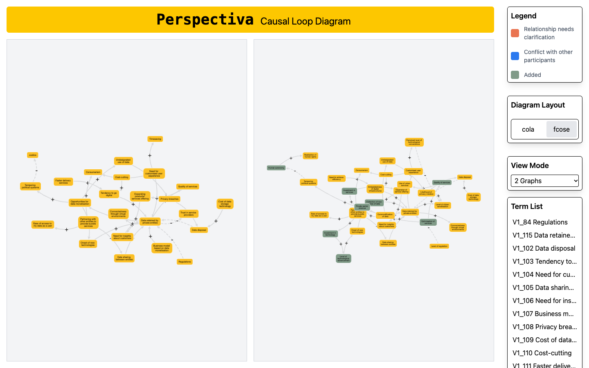
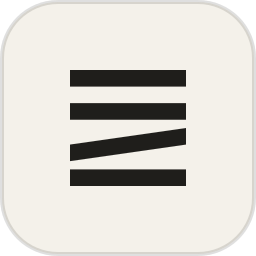
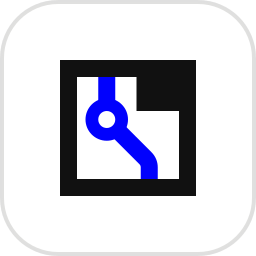
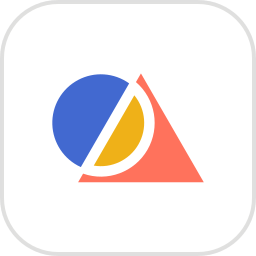

<h1 align="center">
  <a href="https://cytocausal.songhai.site/en/">
    <picture>
      <source media="(prefers-color-scheme: dark)" srcset=".github/brand/lockup-dark.svg" />
      
    </picture>
  </a>
</h1>

<p align="center"><b>A React library for causal graph interfaces, built on Cytoscape.js.</b></p>

<p align="center">
  <a href="https://cytocausal.songhai.site/en/">Documentation</a> ·
  <a href="https://cytocausal.songhai.site/en/showcase/">Showcase</a> ·
  <a href="https://cytocausal-studio.songhai.site">Studio</a> ·
  <a href="#get-started">Get started</a> ·
  <a href="README.zh-CN.md">中文</a>
</p>



Build React interfaces where people can explore causes and effects, trace the evidence behind a relationship, and compare how a model changes. Use the complete workspace or compose your own interface from its components.

## Built for causal graphs

- **Trace evidence.** Keep sources and contributors attached to nodes and links. Inspect agreement and differences between people's models.
- **Compare versions.** Follow nodes across renames, merges and splits using explicit correspondences, stable layouts and animated transitions.
- **Explore cause and effect.** Navigate upstream and downstream, find directed paths, and inspect feedback loops, classified as reinforcing or balancing when polarity is known.

cytocausal adds causal semantics, UX and APIs on top of Cytoscape.js. It uses the relationships supplied in your data; displaying and analysing a graph does not establish that those relationships are causal.

## From library to application

There are two application paths:

- **Your own project — available now.** Start with the React / Next.js starter, replace its data and compose the interface you need.
- **Online drawing — Studio.** Add nodes and directed links, edit labels and polarity, then explore the graph. Work is saved in your browser, with JSON import/export for backups. No account or cloud synchronisation.

Start with `@cytocausal/react`: use the complete workspace or compose components. Cytoscape.js supplies the graph engine; cytocausal supplies causal semantics, analysis and React interactions. Next.js is used by the starter and applications, rather than being the library’s required UI framework.

For authoring, use `CausalEditor`: edit rings, inline naming, cause/effect connections, polarity, and undo/redo with an `onChange` callback. Studio uses this same component and adds local saving and file operations. The minimal host example is at `apps/starter/src/components/EditorExample.tsx`; run the starter and open `/editor`. Import both `@cytocausal/react/styles.css` and `@cytocausal/react/editor.css`.

The implementation is organised into three packages:

| Package | Responsibility |
| --- | --- |
| `@cytocausal/core` | Renderer-independent data model, provenance, validation, versions and causal analysis; no runtime dependencies |
| `@cytocausal/cytoscape` | Cytoscape.js integration: causal styles, layouts, transitions and highlighting |
| `@cytocausal/react` | Complete `CausalWorkspace`, composable UI components and interaction hooks |

## A complete workspace

Inside the starter, a dataset becomes an interactive interface:

```tsx
"use client";

import type { CausalDataset } from "@cytocausal/core";
import { CausalWorkspace } from "@cytocausal/react";
import "@cytocausal/react/styles.css";

export function App({ dataset }: { dataset: CausalDataset }) {
  return <CausalWorkspace dataset={dataset} title="My causal graph" />;
}
```

Use `CausalProvider`, `CausalGraph` and individual panels when you want to assemble your own layout. See the [component guide](apps/docs/src/content/en/components.md).

## Get started

Use Node.js 22.18 or later. Compiled packages are available as versioned tarballs in [GitHub Releases](https://github.com/SonghaiFan/cytocausal/releases/tag/v0.1.0-alpha.1). They are not yet published on npm. The source workspaces remain private packages for local development.

```sh
git clone https://github.com/SonghaiFan/cytocausal.git
cd cytocausal
npm install
npm run dev
```

Open `http://localhost:3102`. Replace the fictional coffee shop model in `apps/starter/src/data.ts`, then customise `apps/starter/src/components/App.tsx`.

To browse the homepage, live showcase and bilingual guides:

```sh
npm run dev:docs
```

Open `http://localhost:3200/en/` or `http://localhost:3200/zh-cn/`.

## See it in use

| Application | What it demonstrates | Repository and live app |
| --- | --- | --- |
| [Perspectiva](apps/docs/src/content/en/case-perspectiva.mdx) | Comparing causal loop diagrams from participatory workshops, tracing terms and combining perspectives | [Independent repo](https://github.com/SonghaiFan/perspectiva) · [Live app](https://perspectiva.songhai.site) |
| [ACCESS Explorer](apps/docs/src/content/en/case-explorer.mdx) | Searching an event network, reading source descriptions and exploring causes, effects and loops | [Independent repo](https://github.com/SonghaiFan/access) · [Live app](https://access.songhai.site) |

The [showcase](apps/docs/src/content/en/showcase.mdx) uses a small fictional dataset to demonstrate the workspace, styles, comparison and individual panels. Run the docs site to interact with it.

## Examples and API

- [Bring your own data](apps/docs/src/content/en/import-data.mdx): parse, validate, render, attach evidence and compare versions.
- [Independent examples](apps/docs/src/content/en/examples.md): complete runnable source for workspace, composition, comparison and analysis.
- API reference: [Core](apps/docs/src/content/en/api-core.md) · [React](apps/docs/src/content/en/api-react.md) · [Cytoscape](apps/docs/src/content/en/api-cytoscape.md).
- [Visual identity](apps/docs/src/content/en/brand.md): the yellow causal sunburst and reusable brand assets.

## Development and status

The library, starter and examples are under active development. Studio is an initial browser-local editor; versioned standalone packages are distributed through GitHub Releases. See [the project plan](docs/PLAN.md).

| Command | Purpose |
| --- | --- |
| `npm test` | Unit tests |
| `npm run typecheck` | Type checks |
| `npm run check:content` | Documentation content checks |
| `npm run build` | Build all apps |
| `npm run test:e2e` | Browser tests after a build; requires Chrome |

For deployed apps, set `NEXT_PUBLIC_STUDIO_URL`, `NEXT_PUBLIC_PERSPECTIVA_URL` and `NEXT_PUBLIC_EXPLORER_URL` on the docs, and `NEXT_PUBLIC_DOCS_URL` on the apps. Case app links default to their public domains. See the [deployment guide](docs/deployment/README.md) for GitHub Pages and the three Vercel projects.

Contributions are welcome; see [CONTRIBUTING.md](CONTRIBUTING.md).

## License

Code and documentation use the [MIT license](LICENSE). Datasets and the logo have separate terms: see [DATA.md](DATA.md).

<br />

<p align="center">
  <a href="https://syuze.songhai.site"></a>&nbsp;
  <a href="https://news-metro.songhai.site"></a>&nbsp;
  <a href="https://narrative-graph.songhai.site"></a>&nbsp;
  <a href="https://visdelta.songhai.site"></a>&nbsp;
  <a href="https://cytocausal.songhai.site"></a>&nbsp;
  <a href="https://aethel.songhai.site"></a>
</p>

<p align="center"><sub>cytocausal is part of the Frank series.</sub></p>

<p align="right">
  <picture>
    <source media="(prefers-color-scheme: dark)" srcset=".github/brand/frank-signature-dark.svg" />
    
  </picture>
</p>
