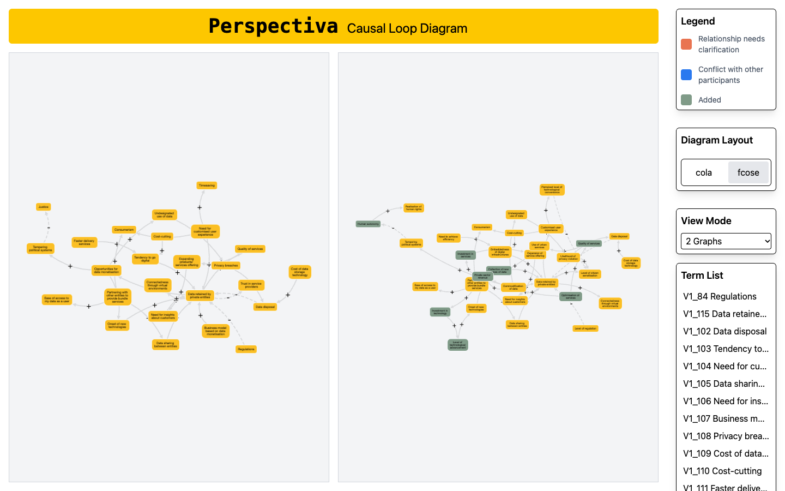
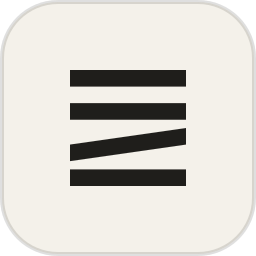
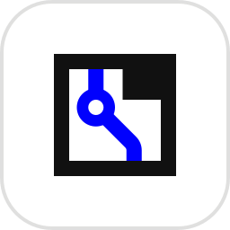
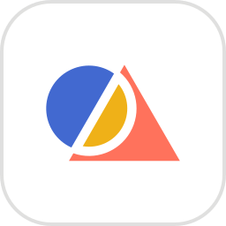

<h1 align="center">
  <a href="https://cytocausal.songhai.site/zh-cn/">
    <picture>
      <source media="(prefers-color-scheme: dark)" srcset=".github/brand/lockup-dark.svg" />
      
    </picture>
  </a>
</h1>

<p align="center"><b>基于 Cytoscape.js 的因果图 React 库。</b></p>

<p align="center">
  <a href="https://cytocausal.songhai.site/zh-cn/">中文文档</a> ·
  <a href="https://cytocausal.songhai.site/zh-cn/showcase/">Showcase</a> ·
  <a href="https://cytocausal-studio.songhai.site">Studio</a> ·
  <a href="#开始使用">开始使用</a> ·
  <a href="README.md">English</a>
</p>



用 React 构建让人探索原因与结果、追溯关系依据、比较模型变化的界面。可以直接使用完整的 Workspace，也可以用其中的组件组合出自己的界面。

## 为因果图而设计

- **追溯依据。** 保留节点和连线的出处与贡献者，查看多人模型中的共识与分歧。
- **比较版本。** 用明确的节点对应关系、稳定的布局和动画过渡，跟随节点的改名、合并与拆分。
- **探索原因与结果。** 沿上游和下游导航，查找有向路径，查看反馈回路；极性已知时区分增强回路与平衡回路。

cytocausal 在 Cytoscape.js 之上提供因果语义、交互体验和 API。它使用你的数据中给出的关系；展示和分析一张图，并不能证明这些关系就是因果关系。

## 从库到应用

有两条应用路径：

- **你自己的项目：现在可用。** 从 React / Next.js starter 开始，换上自己的数据，组合出你需要的界面。
- **在线绘图：Studio。** 添加节点和有向连线，编辑名称和极性，然后探索这张图。作品保存在浏览器中，支持 JSON 导入导出作为备份。没有账号，也没有云同步。

从 `@cytocausal/react` 开始：使用完整的 Workspace，或者组合组件。Cytoscape.js 提供图引擎；cytocausal 提供因果语义、分析和 React 交互。Next.js 用于 starter 和各个应用，并不是这个库必需的 UI 框架。

需要编辑时，使用 `CausalEditor`：编辑圆环、就地命名、原因/结果连接、极性，以及带 `onChange` 回调的撤销/重做。Studio 使用的就是这个组件，另外加上了本地保存和文件操作。最简的宿主示例在 `apps/starter/src/components/EditorExample.tsx`；运行 starter 后打开 `/editor`。需要同时引入 `@cytocausal/react/styles.css` 和 `@cytocausal/react/editor.css`。

实现分为三个包：

| 包 | 职责 |
| --- | --- |
| `@cytocausal/core` | 与渲染无关的数据模型、出处、校验、版本和因果分析；没有运行时依赖 |
| `@cytocausal/cytoscape` | Cytoscape.js 集成：因果样式、布局、过渡和高亮 |
| `@cytocausal/react` | 完整的 `CausalWorkspace`、可组合的 UI 组件和交互 hooks |

## 完整的 Workspace

在 starter 中，一个数据集就能变成可交互的界面：

```tsx
"use client";

import type { CausalDataset } from "@cytocausal/core";
import { CausalWorkspace } from "@cytocausal/react";
import "@cytocausal/react/styles.css";

export function App({ dataset }: { dataset: CausalDataset }) {
  return <CausalWorkspace dataset={dataset} title="My causal graph" />;
}
```

想自己组织布局时，使用 `CausalProvider`、`CausalGraph` 和各个面板。见[组件指南](apps/docs/src/content/zh-cn/components.md)。

## 开始使用

需要 Node.js 22.18 或更新版本。编译好的包以带版本号的 tarball 形式发布在 [GitHub Releases](https://github.com/SonghaiFan/cytocausal/releases/tag/v0.1.0-alpha.1)，尚未发布到 npm。源码工作区仍然是用于本地开发的私有包。

```sh
git clone https://github.com/SonghaiFan/cytocausal.git
cd cytocausal
npm install
npm run dev
```

打开 `http://localhost:3102`。把 `apps/starter/src/data.ts` 中虚构的咖啡店模型换成你的数据，然后修改 `apps/starter/src/components/App.tsx`。

浏览首页、交互示例和中英文指南：

```sh
npm run dev:docs
```

打开 `http://localhost:3200/zh-cn/` 或 `http://localhost:3200/en/`。

## 实际应用

| 应用 | 展示了什么 | 仓库与在线应用 |
| --- | --- | --- |
| [Perspectiva](apps/docs/src/content/zh-cn/case-perspectiva.mdx) | 比较参与式工作坊中的因果回路图，追溯术语，合并不同视角 | [独立仓库](https://github.com/SonghaiFan/perspectiva) · [在线应用](https://perspectiva.songhai.site) |
| [ACCESS Explorer](apps/docs/src/content/zh-cn/case-explorer.mdx) | 搜索事件网络，阅读原始描述，探索原因、结果与回路 | [独立仓库](https://github.com/SonghaiFan/access) · [在线应用](https://access.songhai.site) |

[Showcase](apps/docs/src/content/zh-cn/showcase.mdx) 用一个小型虚构数据集展示 Workspace、样式、比较和各个面板。运行文档站即可交互体验。

## 示例与 API

- [接入自己的数据](apps/docs/src/content/zh-cn/import-data.mdx)：解析、校验、渲染、附加依据和比较版本。
- [独立示例](apps/docs/src/content/zh-cn/examples.md)：Workspace、组合、比较和分析的完整可运行源码。
- API 参考：[Core](apps/docs/src/content/zh-cn/api-core.md) · [React](apps/docs/src/content/zh-cn/api-react.md) · [Cytoscape](apps/docs/src/content/zh-cn/api-cytoscape.md)。
- [视觉识别](apps/docs/src/content/zh-cn/brand.md)：黄色的因果日晕标志和可复用的品牌素材。

## 开发与状态

库、starter 和示例仍在积极开发中。Studio 是一个初版的浏览器本地编辑器；带版本号的独立包通过 GitHub Releases 分发。见[项目计划](docs/PLAN.md)。

| 命令 | 用途 |
| --- | --- |
| `npm test` | 单元测试 |
| `npm run typecheck` | 类型检查 |
| `npm run check:content` | 文档内容检查 |
| `npm run build` | 构建所有应用 |
| `npm run test:e2e` | 构建后的浏览器测试；需要 Chrome |

部署时，在文档站设置 `NEXT_PUBLIC_STUDIO_URL`、`NEXT_PUBLIC_PERSPECTIVA_URL` 和 `NEXT_PUBLIC_EXPLORER_URL`，在各个应用中设置 `NEXT_PUBLIC_DOCS_URL`。案例应用链接默认指向它们的公开域名。GitHub Pages 和三个 Vercel 项目的部署见[部署指南](docs/deployment/README.md)。

欢迎贡献，见 [CONTRIBUTING.md](CONTRIBUTING.md)。

## 许可

代码和文档采用 [MIT 许可](LICENSE)。数据集和标志另有条款，见 [DATA.md](DATA.md)。

<br />

<p align="center">
  <a href="https://syuze.songhai.site"></a>&nbsp;
  <a href="https://news-metro.songhai.site"></a>&nbsp;
  <a href="https://narrative-graph.songhai.site"></a>&nbsp;
  <a href="https://visdelta.songhai.site"></a>&nbsp;
  <a href="https://cytocausal.songhai.site"></a>&nbsp;
  <a href="https://aethel.songhai.site"></a>
</p>

<p align="center"><sub>cytocausal 是 Frank 系列的一部分。</sub></p>

<p align="right">
  <picture>
    <source media="(prefers-color-scheme: dark)" srcset=".github/brand/frank-signature-dark.svg" />
    
  </picture>
</p>
