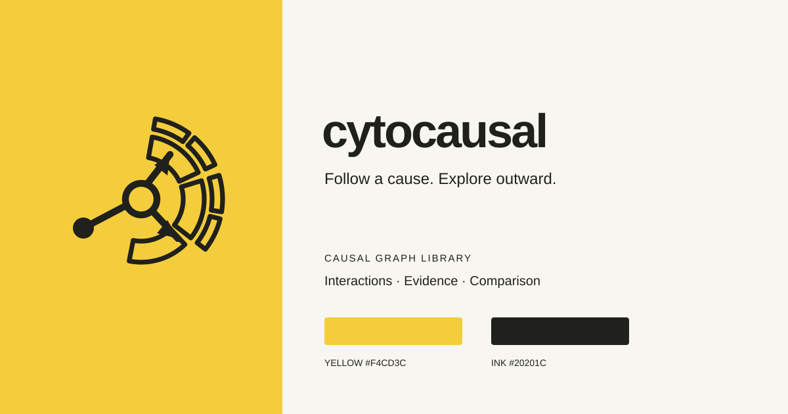

# Visual identity

## The visual hammer: a yellow causal sunburst

A rounded yellow tile, two black nodes joined by an arrow, and two solid ochre sunburst sectors around the destination node. The sectors echo the radial exploration interaction: start at a node, follow a direction and reach the next layer. Repeat this silhouette across the site, app entry and repository artwork.

**Verbal companion:** Follow a cause. Explore outward.

The mark expresses directed relationships and progressive exploration; it is not a promise that every dataset contains a loop or that the library proves causation.

## Logo assets

- [Primary mark — SVG](/brand/mark.svg): navigation, favicon, repository avatar and small application marks.
- [Wordmark — SVG](/brand/wordmark.svg): presentations and light-background headers. The bold lowercase wordmark is plain black text, separate from the yellow mark. All letters are vector outlines, so rendering does not depend on installed fonts.
- [Dark-background wordmark — SVG](/brand/wordmark-dark.svg): uses the same lettering in a light colour.
- [Monochrome mark — SVG](/brand/mark-mono.svg): one-colour printing, with the yellow field omitted.
- [Identity board — SVG](/brand/identity.svg): project introduction and presentation reference.

The primary mark is the canonical 100 × 100 vector. Use at 24 px or larger in interfaces; 16 px is reserved for the favicon. Leave at least 12/100 of its width as clear space. Keep the arrow, node positions and proportions unchanged. Do not stretch, add shadows, rotate or replace the yellow with unrelated accents.

## Palette and type

| Token | Value | Use |
| --- | --- | --- |
| Yellow | `#FBC92B` | Logo field, primary action, restrained brand accents |
| Ochre | `#B99825` | The two sunburst sectors |
| Ink | `#20201B` | Mark, text on yellow, primary text |
| Paper | `#FCF9F2` | Optional presentation background |
| Dark text accent | `#53420B` | Readable brand links on a light background |

Use ink text on yellow; never white text on yellow. In dark mode keep the yellow mark and use yellow as a text accent. Use the site's existing sans-serif stack and a lowercase `cytocausal` wordmark. Code remains monospace.

## Repeat the shape, not just the colour

Use one yellow sunburst at the start of a page or in its navigation. Pair it with a short statement about the task, then let the real graph provide the detail. Repository artwork and presentation covers can enlarge the same mark against a solid yellow field. Avoid decorative networks, generic gradients and multiple competing logo variants.

Keep the graph’s semantic colours distinguishable when applying the brand. The logo is static; graph animations follow the user’s reduced-motion preference.

## Scope and attribution

These cytocausal SVG assets are included under the repository's MIT license. The Monash University logo used in the Explorer case is a separate third-party asset and is not part of this identity. See [DATA.md](https://github.com/SonghaiFan/cytocausal/blob/main/DATA.md).
