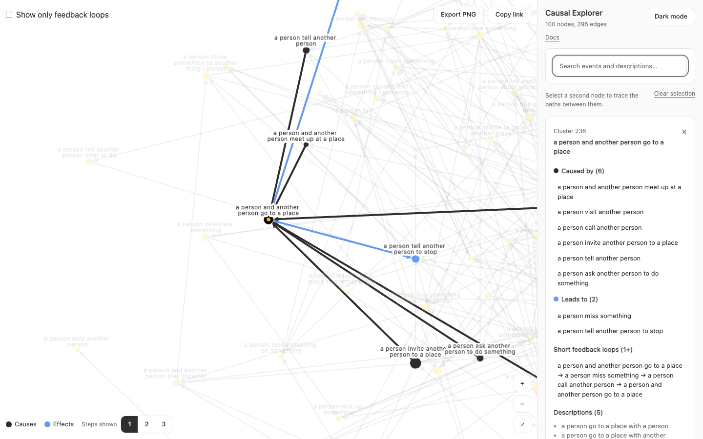

# Case study: Causal Explorer

Causal Explorer shows a network of cause and effect extracted from text. Sentences are clustered with natural language processing, and links between clusters come from causal cues in the source material. The question is how events connect at scale.



| Item | Details |
| :--- | :--- |
| Data | One network, in one snapshot |
| Size | 725 nodes and 1,494 edges |
| Links | Directed, without polarity |
| Evidence | 4,708 source sentences |
| Positions | Precomputed |

## What it needed

- Finding events by what they mean, not just by name
- Reading the sentences behind a node
- Seeing what causes a node and what it leads to
- A readable view of a dense graph

## What was wrong

The original app ran on Sigma, and its data was sound. The problems were in exploring it:

- Search only matched the start of a label, and 716 of 725 labels start with "a person". Searching for `sleep` found nothing.
- Sentences appeared in a hover card that vanished when the mouse moved away.
- Highlighting didn't separate causes from effects.
- Node sizes ignored direction.
- Every node was its own cluster, so the filters added up to 1,450 checkboxes that couldn't group anything.

## Moving to Cytoscape

The move depended on one question: could Cytoscape draw this graph with labels? [Benchmarks](/en/scale-performance/) showed 60 fps, so both demos could share one engine.

The harder problem was keeping labels readable, which took collision handling.

## How the framework solved it

| Need | Mechanism | Chapter |
| :--- | :--- | :--- |
| Directed node sizes | `analyzeSnapshot` | [Causal analysis](/en/causal-analysis/) |
| Feedback loop toggle | `feedbackGroups` | [Causal analysis](/en/causal-analysis/) |
| Causes and effects | `highlightCausalNeighbours` | [Causal analysis](/en/causal-analysis/) |
| Fast first render | Saved positions | [Scale and performance](/en/scale-performance/) |
| Readable labels | Collision handling | [Scale and performance](/en/scale-performance/) |
| Selection and hover | `onReady` | [React lifecycle](/en/react-lifecycle/) |

## Result

Search now finds words anywhere in labels and sentences. Clicking a node keeps its sentences, causes and effects in a side panel, and a second click compares two nodes. The analysis also found something new: 213 of the 725 nodes form a single set of feedback loops, so the network isn't a simple chain of causes.

## Run it

```sh
npm install
npm run dev:explorer
```

Open `http://localhost:3101`.
