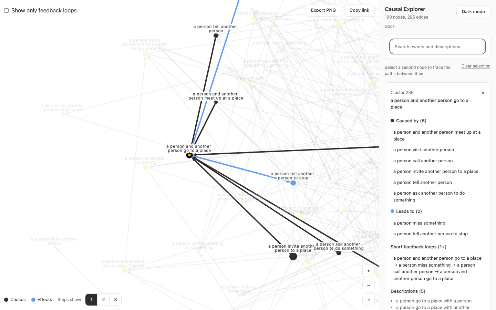

import { OpenApp } from "../../components/OpenApp.tsx";

# Case study: Causal Explorer

<OpenApp app="explorer">Open the app</OpenApp>

Causal Explorer shows the causal graph from the ACCESS benchmark, which covers abstract events in everyday life. Generalised event descriptions from the GLUCOSE dataset were clustered into abstract events, and annotators judged the causal links between them. The question is how events connect at scale.



| Item | Details |
| :--- | :--- |
| Data | One network, in one snapshot |
| Size | 725 nodes and 1,494 edges |
| Links | Directed, without polarity |
| Evidence | 4,708 generalised event descriptions |
| Positions | Precomputed for the full benchmark, with force and centrality layouts worked out in the browser |

The figures above describe the full benchmark. The public demo shows a sample of its 100 most central events, and the full benchmark is [available on request](https://github.com/isVy08/ACCESS).

## What it needed

- Finding events by what they mean, not just by name
- Reading the sentences behind a node
- Seeing what causes a node and what it leads to
- A readable view of a dense graph

## How the framework solved it

| Need | Mechanism | Guide |
| :--- | :--- | :--- |
| Directed node sizes | `analyzeSnapshot` | [Causal analysis](/en/causal-analysis/) |
| Feedback loop toggle | `feedbackGroups` | [Causal analysis](/en/causal-analysis/) |
| Short loops through a node | `findFeedbackLoops` | [Causal analysis](/en/causal-analysis/) |
| Causes and effects | `highlightCausalNeighbours` | [Causal analysis](/en/causal-analysis/) |
| Fast first render | Saved positions | [Scale and performance](/en/scale-performance/) |
| Readable labels | `readableLabels` | [Scale and performance](/en/scale-performance/) |
| Selection and hover | `useCausalGraph` | [Interactions](/en/interactions/) |
| Searching labels and descriptions | `NodeSearch`, `focusNode` | [Getting started](/en/getting-started/) |

## Result

Search matches words within labels and descriptions. Selecting a node keeps its descriptions, causes and effects in the sidebar. Multi-selection connects reachable selections with directed paths.

The sample keeps positions worked out for all 725 nodes, so it has gaps where the others were. The app offers a force layout for the displayed nodes and rings by centrality. With a computed layout, showing only feedback loops lays out the loops on their own. Zooming spreads nodes apart while every mark keeps its size, and a switch compares this with the other [zoom modes](/en/theming/).

## Publication

The graph comes from [ACCESS: A Benchmark for Abstract Causal Event Discovery and Reasoning](https://arxiv.org/abs/2502.08148) (NAACL 2025), which is built on [GLUCOSE](https://arxiv.org/abs/2009.07758). GLUCOSE's license limits this data to non-commercial use.

## Run it

```sh
npm install
npm run dev:explorer
```

Open `http://localhost:3101`.

Set `NEXT_PUBLIC_PERSPECTIVA_URL` and `NEXT_PUBLIC_EXPLORER_URL` when building the docs to point the **Open the app** buttons at deployed apps. Without them, the buttons open the local servers, so start the app first.
