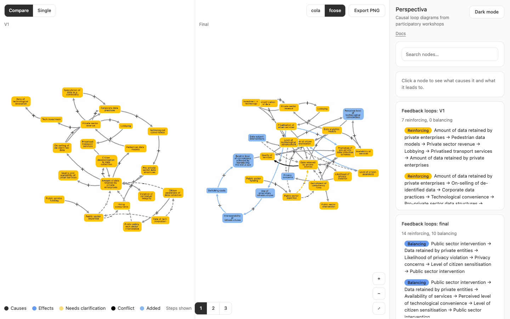

# Case study: Perspectiva

Perspectiva compares versions of causal loop diagrams from participatory workshops. Each participant drew a first diagram, and the researchers produced a final version with standardised terms. The research question is what changed.



| Item | Details |
| :--- | :--- |
| Data | 8 participants, each with V1 and final snapshots |
| Size | Up to 32 nodes per diagram |
| Links | Directed, with polarity |
| Evidence | Each participant's original terms |
| Correspondences | 129 V1 nodes linked to final nodes |

## What it needed

- Two versions side by side, with matching nodes in the same place
- Movement between versions on one graph
- A way to see where each term came from

## The alignment problem

The original app matched nodes by id, on the assumption that a node keeps its id across versions. It doesn't:

- V1 ids came from a master id column, while final ids came from a mapping index.
- When several V1 nodes merged into one, only the last row's index was kept.

Only 44 of 126 mapped pairs shared an id, and three datasets shared none, so the view looked aligned but wasn't.

Rewriting the ids wasn't an option, because merged nodes would collide. The mapping table was already the source of truth, so it became a [correspondence](/en/data-model/), which left the data untouched.

## How the framework solved it

| Need | Mechanism | Chapter |
| :--- | :--- | :--- |
| Matching nodes across versions | `Correspondence` | [Data model](/en/data-model/) |
| Side-by-side comparison | `CompareView` | [Stable layouts](/en/stable-layouts/) |
| Moving between versions | `animateSnapshots` | [Version transitions](/en/version-transitions/) |
| Original terms on hover | `Evidence`, `renderTooltip` | [React lifecycle](/en/react-lifecycle/) |

## Result

Alignment offsets are now 0 for every anchored node in all 8 datasets with fcose, and on `expert_9` with cola. Switching versions keeps one graph, and positions match between the two views. Playwright tests check this for every dataset, including rapid switching.

Validation also found a duplicate link in one diagram. It was harmless, and the importer now merges exact repeats.

## Run it

```sh
npm install
npm run dev:perspectiva
```

Open `http://localhost:3100`. Add `?dataset=expert_9` to choose a dataset, and `?debug=1` to show the dataset selector.
