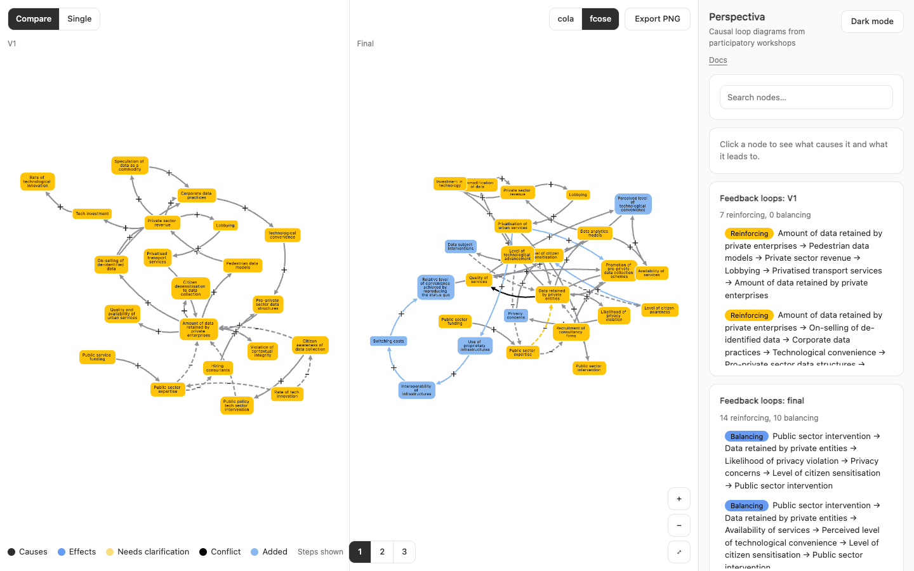

import { OpenApp } from "../../components/OpenApp.tsx";

# Case study: Perspectiva

<OpenApp app="perspectiva">Open the app</OpenApp>

Perspectiva compares versions of causal loop diagrams from participatory workshops. Each participant drew a first diagram, and the researchers produced a final version with standardised terms. The research question is what changed.



| Item | Details |
| :--- | :--- |
| Data | 8 participants, each with V1 and final snapshots, and the whole workshop combined |
| Size | Up to 32 nodes per diagram |
| Links | Directed, with polarity |
| Evidence | Each participant's original terms |
| Correspondences | 129 V1 nodes linked to final nodes |

## What it needed

- Two versions side by side, with matching nodes in the same place
- Movement between versions on one graph
- A way to see where each term came from

## Matching versions

Node IDs can differ between versions, and multiple original terms can merge into one final term. Perspectiva uses explicit [correspondences](/en/data-model/) from the source mapping table to match these nodes while preserving their original IDs.

## How the framework solved it

| Need | Mechanism | Guide |
| :--- | :--- | :--- |
| Matching nodes across versions | `Correspondence` | [Data model](/en/data-model/) |
| Side-by-side comparison | `CompareView`, with any version on either side | [Stable layouts](/en/stable-layouts/) |
| Changes in either order | `diffSnapshots`, `followNodes` | [Causal analysis](/en/causal-analysis/) |
| Moving between versions | `animateSnapshots` | [Version transitions](/en/version-transitions/) |
| Original terms in the sidebar | `Evidence`, `SelectionPanel` | [React lifecycle](/en/react-lifecycle/) |
| Reinforcing and balancing loops | `findFeedbackLoops` | [Causal analysis](/en/causal-analysis/) |

## Result

Corresponding nodes share anchored coordinates across the comparison views. Switching versions in one graph shows their movement and reuses cached positions.

The app also lists each diagram's feedback loops, 89 in total, and highlights the one you choose. Two participants' diagrams have no loops in either version.

The importer merges exact duplicate links.

## The whole workshop

Each participant's diagram stands alone, but the research is about the workshop. Choose **Whole workshop** in the menu to see all 8 diagrams combined with `combineDatasets`. Node ids differ between participants, so terms are matched by their shared key instead. The final version has 107 terms and 206 links. 24 links were drawn by more than one participant, and one by four, so the line width shows where people agree. On 4 links, participants disagree on the polarity, and both versions are shown. The contributor filter shows one participant's part of the combined map without moving it. See [Provenance and agreement](/en/provenance/).

## Publication

Perspectiva was published as *Out of the Loop: Enhancing Documentation and Transparency in Causal Loop Diagrams to Capture Multiple Perspectives* (IEEE VIS 2025, Best Short Paper), by Jessica Bou Nassar, Yu Xuan Yio, Nethara Athukorala, Simran, Songhai Fan, Cynthia Huang, Lyn Bartram, Tim Dwyer and Sarah Goodwin. In its user studies, domain and visualisation experts reported better navigation, comparison and provenance tracking than with static diagrams.

## Run it

```sh
npm install
npm run dev:perspectiva
```

Open `http://localhost:3100`. Add `?dataset=expert_9` to choose a dataset, and `?debug=1` to show the dataset selector.

Set `NEXT_PUBLIC_PERSPECTIVA_URL` and `NEXT_PUBLIC_EXPLORER_URL` when building the docs to point the **Open the app** buttons at deployed apps. Without them, the buttons open the local servers, so start the app first.
