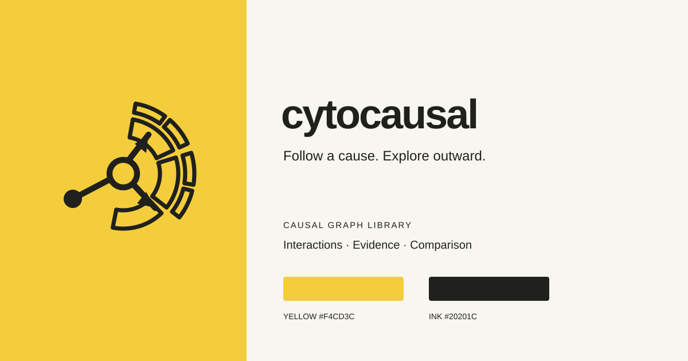

# 视觉识别

## 视觉锤：黄色因果扇区

黄色圆角底、两个由箭头连接的黑色节点，以及围绕目标节点展开的两片深黄色 sunburst 实心扇区。扇区呼应径向探索交互：从节点出发，选择方向，探索下一层关系。让这个轮廓持续出现在首页、应用入口和仓库展示图中。

**配套表达：从一个节点，展开因果。** 英文为 “Follow a cause. Explore outward.”

标记表达有向关系与逐层探索，不表示每份数据都包含回路，也不表示 library 能证明因果关系。

## Logo 素材

- [主标记 SVG](/brand/mark.svg)：导航、favicon、仓库头像和小尺寸应用标记。
- [组合字标 SVG](/brand/wordmark.svg)：演示文稿、浅色背景页头。粗体小写字标为纯黑文字，与黄色图标分开使用。所有字母已转为矢量轮廓，不依赖设备安装字体。
- [深色背景字标 SVG](/brand/wordmark-dark.svg)：字形相同，使用浅色填充。
- [单色标记 SVG](/brand/mark-mono.svg)：单色印刷，去除黄色底。
- [视觉规范图 SVG](/brand/identity.svg)：项目介绍与演示参考。

主标记采用 100 × 100 矢量画布。界面中建议不小于 24 px，16 px 仅用于 favicon。四周保留至少标记宽度 12/100 的留白。箭头、节点位置与比例保持固定；不要拉伸、加阴影、旋转或随意替换黄色。

## 色彩与字体

| Token | 色值 | 用途 |
| --- | --- | --- |
| Yellow | `#FBC92B` | Logo 底色、主要操作、少量品牌强调 |
| Ochre | `#B99825` | 两片 sunburst 扇区 |
| Ink | `#20201B` | 标记、黄色上的文字、主要文字 |
| Paper | `#FCF9F2` | 演示材料的可选底色 |
| Dark text accent | `#53420B` | 浅色背景上的可读品牌链接 |

黄色上使用深色文字，不使用白字。深色模式保留黄色标记，可用黄色强调文字。沿用站点的无衬线字体，字标固定小写 `cytocausal`，代码使用等宽字体。

## 重复形状，而不只是重复黄色

在页首或导航放一个黄色因果扇区，用简短文案说明任务，让真实因果图承担细节。仓库展示图、演示封面可以把同一个标记放大，搭配纯黄色块。避免装饰性复杂网络、泛用渐变，以及多个相互竞争的标记版本。

应用品牌时，应保持图中语义色的可区分性。Logo 为静态图形，图的动画遵循用户的减少动态效果设置。

## 使用范围

这组 cytocausal SVG 素材按仓库 MIT 许可提供。Explorer 案例中的 Monash University logo 是独立的第三方标记，不属于这套品牌。详见 [DATA.md](https://github.com/SonghaiFan/cytocausal/blob/main/DATA.md)。
