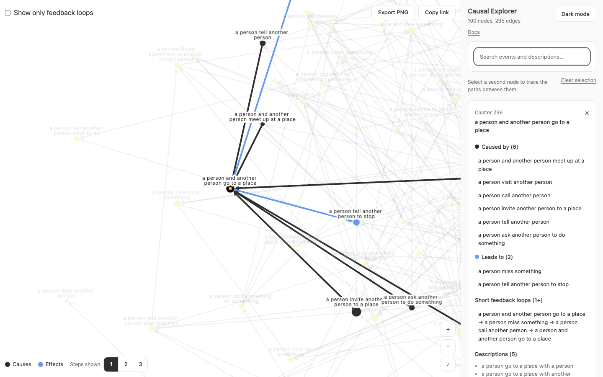

# 案例：Causal Explorer

Causal Explorer 展示从文本中抽取的因果网络。句子通过自然语言处理聚类，聚类之间的连接来自原文中的因果线索。研究问题是事件在大规模下如何相互连接。



| 项目 | 详情 |
| :--- | :--- |
| 数据 | 一个网络，一个快照 |
| 规模 | 725 个节点和 1,494 条边 |
| 连接 | 有向，不带极性 |
| 证据 | 4,708 条原文句子 |
| 位置 | 预先计算 |

## 需求

- 按含义查找事件，而不只是按名称
- 阅读节点背后的句子
- 查看节点的原因和结果
- 让密集的图保持可读

## 原有问题

原应用基于 Sigma，数据本身没有问题，问题出在探索方式上：

- 搜索只匹配标签开头，而 725 个标签中有 716 个以 “a person” 开头。搜索 `sleep` 没有结果。
- 句子显示在悬停卡片中，鼠标移开就消失。
- 高亮不区分原因和结果。
- 节点大小忽略了方向。
- 每个节点都是独立的聚类，所以筛选器变成了 1,450 个无法分组的复选框。

## 迁移到 Cytoscape

迁移取决于一个问题：Cytoscape 能否绘制带标签的这张图？[基准测试](/zh-cn/scale-performance/)显示为 60 fps，所以两个演示可以共用一个引擎。

更难的问题是保持标签可读，这需要碰撞处理。

## 框架如何解决

| 需求 | 机制 | 章节 |
| :--- | :--- | :--- |
| 有向节点大小 | `analyzeSnapshot` | [因果分析](/zh-cn/causal-analysis/) |
| 反馈回路开关 | `feedbackGroups` | [因果分析](/zh-cn/causal-analysis/) |
| 经过节点的短回路 | `findFeedbackLoops` | [因果分析](/zh-cn/causal-analysis/) |
| 原因和结果 | `highlightCausalNeighbours` | [因果分析](/zh-cn/causal-analysis/) |
| 快速首次渲染 | 已保存的位置 | [规模与性能](/zh-cn/scale-performance/) |
| 可读的标签 | 碰撞处理 | [规模与性能](/zh-cn/scale-performance/) |
| 选择和悬停 | `onReady` | [React 生命周期](/zh-cn/react-lifecycle/) |

## 结果

现在搜索能找到标签和句子中任意位置的词。点击节点后，它的句子、原因和结果会保留在侧边面板中，再点击一个节点即可比较。分析还带来了新发现：725 个节点中有 213 个组成一组反馈回路，所以这个网络并不是简单的因果链。

## 运行

```sh
npm install
npm run dev:explorer
```

打开 `http://localhost:3101`。
