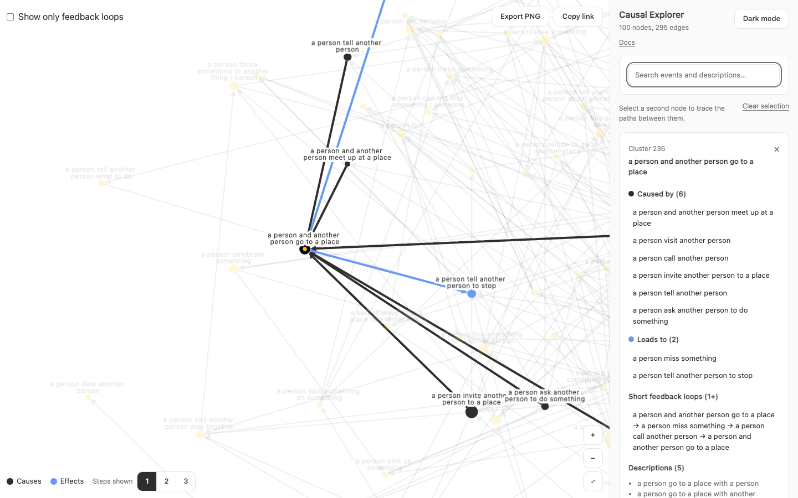

import { OpenApp } from "../../components/OpenApp.tsx";

# 案例：Causal Explorer

<OpenApp app="explorer">打开应用</OpenApp>

Causal Explorer 展示 ACCESS 基准中的因果图，内容是日常生活中的抽象事件。GLUCOSE 数据集中的泛化事件描述被聚类为抽象事件，再由标注者判断它们之间的因果连接。研究问题是事件在大规模下如何相互连接。



| 项目 | 详情 |
| :--- | :--- |
| 数据 | 一个网络，一个快照 |
| 规模 | 725 个节点和 1,494 条边 |
| 连接 | 有向，不带极性 |
| 证据 | 4,708 条泛化事件描述 |
| 位置 | 为完整基准预先计算，另可在浏览器中计算力导向布局和中心性布局 |

上面的数据描述的是完整基准。公开演示只显示其中最核心的 100 个事件，完整基准可[按需申请](https://github.com/isVy08/ACCESS)。

## 需求

- 按含义查找事件，而不只是按名称
- 阅读节点背后的句子
- 查看节点的原因和结果
- 让密集的图保持可读

## 框架如何解决

| 需求 | 机制 | 指南 |
| :--- | :--- | :--- |
| 有向节点大小 | `analyzeSnapshot` | [因果分析](/zh-cn/causal-analysis/) |
| 反馈回路开关 | `feedbackGroups` | [因果分析](/zh-cn/causal-analysis/) |
| 经过节点的短回路 | `findFeedbackLoops` | [因果分析](/zh-cn/causal-analysis/) |
| 原因和结果 | `highlightCausalNeighbours` | [因果分析](/zh-cn/causal-analysis/) |
| 快速首次渲染 | 已保存的位置 | [规模与性能](/zh-cn/scale-performance/) |
| 可读的标签 | `readableLabels` | [规模与性能](/zh-cn/scale-performance/) |
| 选择和悬停 | `useCausalGraph` | [交互](/zh-cn/interactions/) |
| 搜索标签和描述 | `NodeSearch`、`focusNode` | [快速开始](/zh-cn/getting-started/) |

## 结果

搜索可以匹配标签和描述中的词。选择节点后，其描述、原因和结果保留在侧栏中。多选节点时，可达的选择之间通过有向路径连接。

样本沿用了为全部 725 个节点计算的位置，所以在其他节点原来所在的地方留下了空白。应用可为当前显示的节点计算力导向布局，也提供按中心性排列的同心圆。使用计算出的布局时，只看反馈回路会单独为这些回路重新布局。缩放时节点会被拉开，而每个标记的大小保持不变；还可以用切换按钮和其他[缩放模式](/zh-cn/theming/)对比。

## 论文

这张图来自 [ACCESS: A Benchmark for Abstract Causal Event Discovery and Reasoning](https://arxiv.org/abs/2502.08148)（NAACL 2025），它基于 [GLUCOSE](https://arxiv.org/abs/2009.07758) 构建。GLUCOSE 的许可证规定这些数据仅限非商业用途。

## 运行

```sh
npm install
npm run dev:explorer
```

打开 `http://localhost:3101`。

构建文档时设置 `NEXT_PUBLIC_PERSPECTIVA_URL` 和 `NEXT_PUBLIC_EXPLORER_URL`，**打开应用**按钮就会指向已部署的应用。不设置时按钮打开本地服务，所以要先启动应用。
