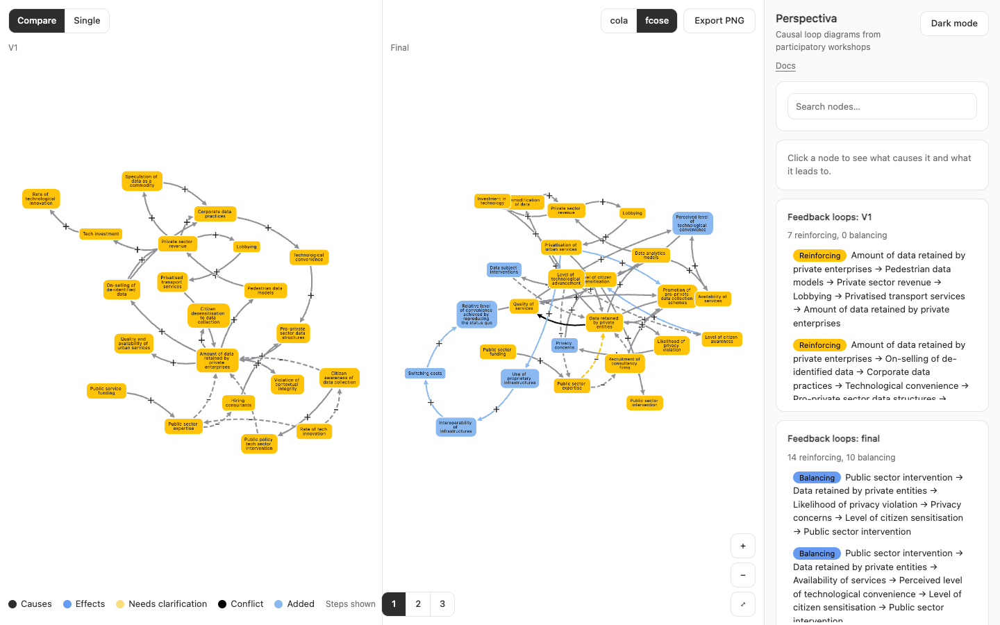

import { OpenApp } from "../../components/OpenApp.tsx";

# 案例：Perspectiva

<OpenApp app="perspectiva">打开应用</OpenApp>

Perspectiva 用于比较参与式工作坊中不同版本的因果回路图。每位参与者先画出第一版图，研究人员再整理出术语统一的最终版。研究问题是两者之间发生了什么变化。



| 项目 | 详情 |
| :--- | :--- |
| 数据 | 8 位参与者，每位都有 V1 和 final 快照，另有合并后的整个工作坊 |
| 规模 | 每张图最多 32 个节点 |
| 连接 | 有向，带极性 |
| 证据 | 每位参与者的原始术语 |
| 对应关系 | 129 个 V1 节点连接到 final 节点 |

## 需求

- 并排显示两个版本，相同节点位于相同位置
- 在同一张图上切换版本
- 能看到每个术语的来源

## 对齐问题

原应用按 ID 匹配节点，假设节点在各版本之间保持同一 ID。事实并非如此：

- V1 的 ID 来自主 ID 列，而 final 的 ID 来自映射索引。
- 多个 V1 节点合并时，只保留了最后一行的索引。

126 对映射节点中只有 44 对 ID 相同，三个数据集完全没有相同 ID，所以视图看起来对齐，实际并没有。

重写 ID 行不通，因为合并节点会发生冲突。映射表本来就是权威来源，所以它成为了[对应关系](/zh-cn/data-model/)，数据本身无需改动。

## 框架如何解决

| 需求 | 机制 | 指南 |
| :--- | :--- | :--- |
| 跨版本匹配节点 | `Correspondence` | [数据模型](/zh-cn/data-model/) |
| 并排比较 | `CompareView`，两侧都可以选择任意版本 | [稳定布局](/zh-cn/stable-layouts/) |
| 按任意顺序比较变化 | `diffSnapshots`、`followNodes` | [因果分析](/zh-cn/causal-analysis/) |
| 在版本之间移动 | `animateSnapshots` | [版本过渡](/zh-cn/version-transitions/) |
| 侧栏显示原始术语 | `Evidence`、`SelectionPanel` | [React 生命周期](/zh-cn/react-lifecycle/) |
| 增强回路和平衡回路 | `findFeedbackLoops` | [因果分析](/zh-cn/causal-analysis/) |

## 结果

使用 fcose 时，全部 8 个数据集的每个锚定节点偏移都为 0；`expert_9` 使用 cola 时也是如此。切换版本时保留同一张图，两种视图中的位置一致。Playwright 测试会对每个数据集检查这些内容，包括快速切换。

应用还会列出每张图的反馈回路，共 89 个，并高亮你选择的回路。有两位参与者的图在两个版本中都没有回路。

验证还发现了一张图中的重复连接。它没有造成影响，现在导入器会合并完全重复的连接。

## 整个工作坊

每位参与者的图各自独立，但研究关注的是整个工作坊。在菜单中选择 **Whole workshop**，就能看到用 `combineDatasets` 合并后的全部 8 张图。参与者之间的节点 id 并不一致，所以术语改按共享的 key 匹配。最终版本共有 107 个术语和 206 条连线，其中 24 条由不止一位参与者画出，有一条由四位参与者画出，所以线宽能体现大家在哪里达成了共识。有 4 条连线，参与者对极性意见不一，两种版本都会显示。提出者筛选器可以在合并后的图中只显示某一位参与者的部分，且不移动任何节点。详见[出处与共识](/zh-cn/provenance/)。

## 论文

Perspectiva 发表于 *Out of the Loop: Enhancing Documentation and Transparency in Causal Loop Diagrams to Capture Multiple Perspectives*（IEEE VIS 2025，最佳短论文），作者为 Jessica Bou Nassar、Yu Xuan Yio、Nethara Athukorala、Simran、Songhai Fan、Cynthia Huang、Lyn Bartram、Tim Dwyer 和 Sarah Goodwin。在用户研究中，领域专家和可视化专家认为，与静态图相比，它改善了导航、比较和来源追溯。

## 运行

```sh
npm install
npm run dev:perspectiva
```

打开 `http://localhost:3100`。添加 `?dataset=expert_9` 选择数据集，添加 `?debug=1` 显示数据集选择器。

构建文档时设置 `NEXT_PUBLIC_PERSPECTIVA_URL` 和 `NEXT_PUBLIC_EXPLORER_URL`，**打开应用**按钮就会指向已部署的应用。不设置时按钮打开本地服务，所以要先启动应用。
